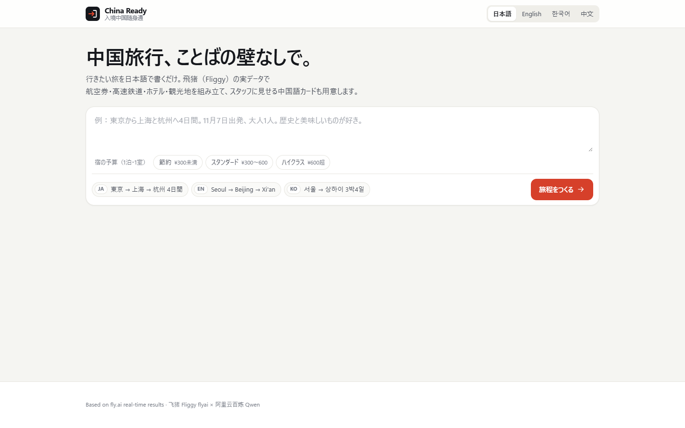
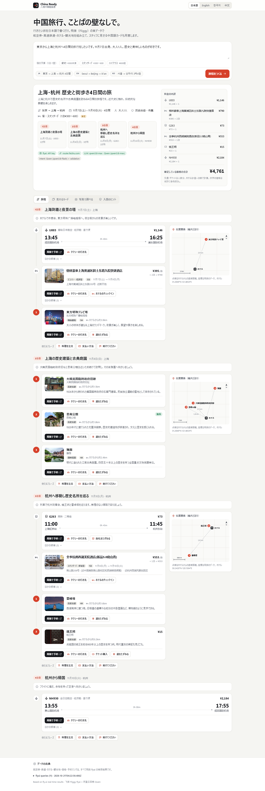
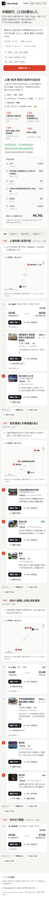
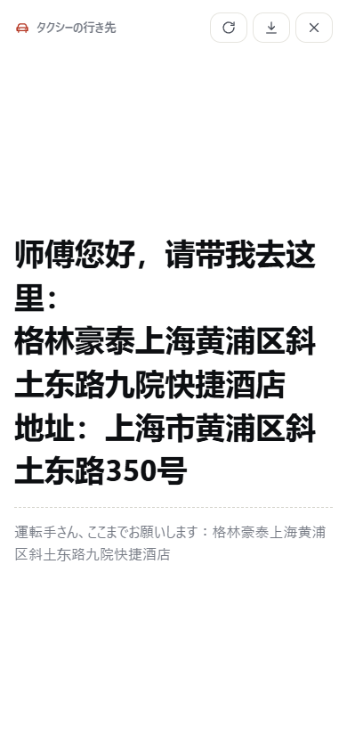
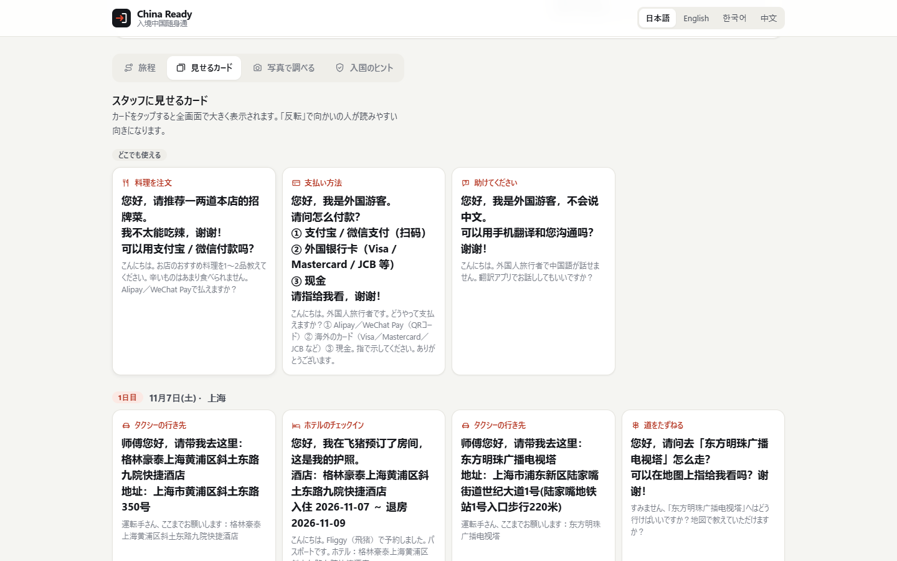
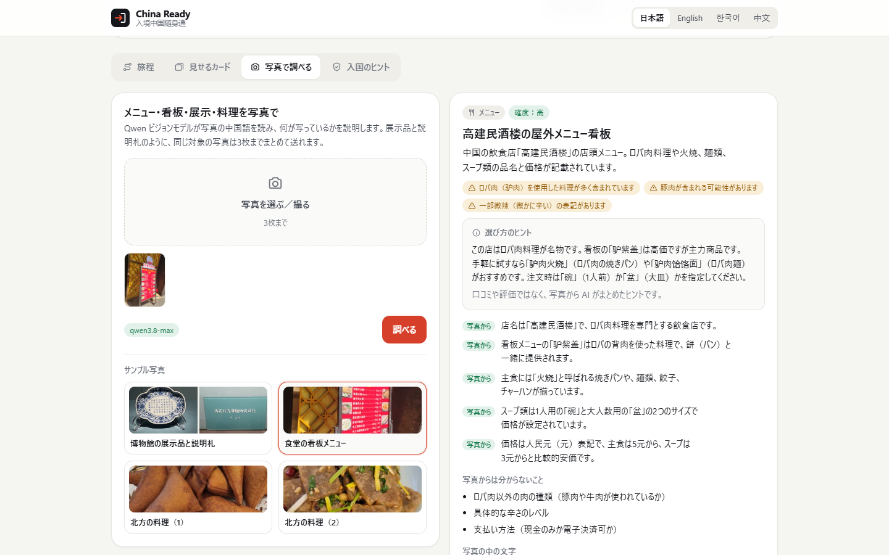
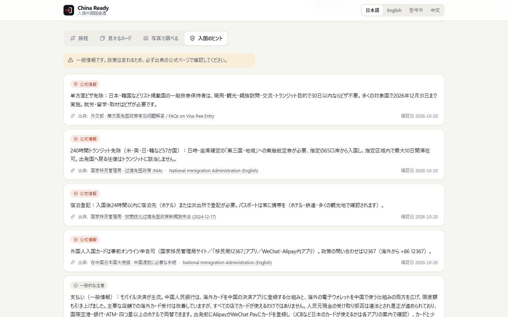
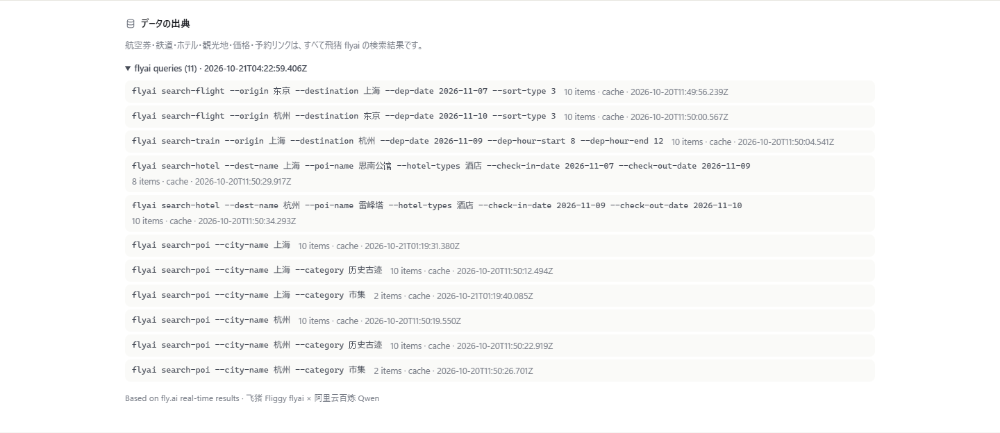

# 入境中国随身通 / China Ready

外国游客用日语、英语或韩语写一句话，系统用**飞猪 flyai 的实时结果**排出逐日行程：国际航班、高铁、酒店、景点。每一站都有飞猪预订链接，以及一张可以递给司机、检票员、前台的中文大字卡片。拍照可以翻译菜单和指示牌、解读博物馆展品、辨认不认识的菜。入境须知只引用官方页面。

在线示例：<https://teifurin.github.io/china-ready/demo/>（录好的示例行程和拍照识别结果）

> **English** — Visitors write one sentence in Japanese, English or Korean, and China Ready turns it into a day-by-day trip built from live Fliggy (flyai) results: flights, high-speed rail, hotels and attractions, each with a booking link and a large-type Chinese card to show staff. A photo tab reads menus and signs, explains museum exhibits and suggests what an unfamiliar dish may be. Intent, trip text and photo reading run on Qwen through Alibaba Cloud Model Studio.

## 运行

需要 Node.js 18 或更新版本。把 `.env.example` 复制为 `.env`，填入百炼按量付费 Key（`DASHSCOPE_API_KEY`）；飞猪 Key（`FLYAI_API_KEY`）可选。

```bash
npm i
npm start
```

打开 <http://localhost:8787/?demo=1>，会生成东京 → 上海 → 杭州、4 天的日语示例行程。

```bash
node src/cli.js --demo
node src/cli.js "From Seoul to Beijing and Xi'an, 5 days from Dec 3, 2 adults. We love history and food." --lang en
node src/cli.js --photo public/photos/exhibit.jpg,public/photos/exhibit-label.jpg --lang ja
npm run offline
npm test
```

`npm run offline` 回放 `fixtures/flyai/` 里录好的飞猪响应，不需要任何 Key。页面参数：`?demo=1|2|3`、`lang=ja|en|ko|zh`、`tab=0-3`。

## 功能

- 行程：每日概览；登机牌式的航班和高铁卡片；按飞猪经纬度画的位置示意图（真实比例，不调用地图服务）；费用明细写成「单价 × 数量」。
- 住宿预算：输入框下可选每晚预算（节省 ¥300 以下、标准 ¥300–600、高档 ¥600 以上，按 1 间房算），句子里写了也会读出来；都没有时按标准档，并标「推定」。命令行用 `--budget economy|standard|upscale`。
- 出示卡片：中文大字加母语释义，可以全屏、翻转给对面的人看、存成 PNG。点餐、付款、求助三张通用卡片放在最前面。
- 拍照识别：一次最多 3 张同一对象的照片，例如展品和它的说明牌。照片里的中文逐行照抄，附拼音、译文和价格；每条说明标出依据（照片可见／常识），看不出来的单独列出；菜品给出最可能的名字和备选中文名，可以拿去问店员。对店铺只说卖什么、招牌菜和价格，不做点评。
- 入境须知：每条官方信息都附出处和核对日期。
- 界面有日、英、韩、中四种语言，按各语言的断行规则排版，桌面和手机都能用。

## 百炼使用说明

作品在**运行时链路**调用阿里云百炼：OpenAI 兼容 API（`src/llm.js`，`fetch`，无 SDK），按量付费 Key（`DASHSCOPE_API_KEY`）。

| 环节 | 模型 | 输入 → 输出 |
| --- | --- | --- |
| 意图 | `qwen3.8-flash` | 用户母语原文 → 出发地、目的地、天数、日期、人数、兴趣、住宿预算（JSON，再经城市白名单校验） |
| 叙述 | `qwen3.8-max` | 已排好的站点 id 和飞猪原文 → 用户语言的标题、每日 tip、景点译名（只能引用传入的 id，不新增地点或价格） |
| 拍照 | `QWEN_VL_MODEL`（本作品用 `qwen3.8-max`） | 1–3 张照片 → 类别、标题、逐行原文和译文、带依据的说明、备选菜名、照片看不出来的内容 |

没有 Key 或设了 `MOCK_LLM=1` 时，叙述用固定模板，拍照明确提示不可用，不编造译文。应用拒绝 `sk-sp-` 开头的 Token Plan Key 和 Token Plan / Coding Plan 地址。

## 数据从哪来

- 航班、火车、酒店、景点、价格、地址和预订链接都来自飞猪 flyai。页脚列出每次查询的命令、条数、来源和取数时间。
- 合计只算真实数字：交通和门票按人数算，酒店按「每晚价 × 晚数」算。体验模式下的打码价（如 `¥4xx`）照原样显示，不计入合计。
- 酒店只在飞猪返回的结果里挑：先看每晚价格是否在预算档内，同一档里优先对应的酒店类别，再按飞猪的顺序。没有这一档时选价格最接近的一家，并在行程头写明。
- 调用飞猪时一次只发一个请求，间隔随机 1.5–3 秒。遇到限流信号（HTTP 429/403/503，或回复里的 `SentinelBlockException`）就暂停 30 分钟，期间改用保存的结果，并在页面上说明。
- 入境须知在 `src/tips.js`，只复述所附官方出处的说法。出示卡片是人工模板（`src/cards.js`），店名和地址原样来自飞猪。

## 在线示例页

`docs/demo/` 是不需要服务器的示例页，部署在 <https://teifurin.github.io/china-ready/demo/>。首屏按浏览器语言显示，选一种语言就打开对应的示例行程：日语为东京 → 上海 → 杭州，英语为首尔 → 北京 → 西安，韩语为首尔 → 上海。行程和照片结果都是应用实际运行时录下的：飞猪数据来自正式 Key（英语示例是体验模式，部分价格打码），文字由 Qwen 生成。页面顶部写明录制时间；它不查询飞猪，也不调用百炼。用自己的句子生成行程、识别自己的照片，需要在本地运行。

```bash
node src/cli.js "<示例句>" --lang ja --out run-ja.json
npm run build:static -- --plan ja=run-ja.json,ko=run-ko.json,en=run-en.json
npm run preview:static
```

## 环境变量

| 变量 | 作用 |
| --- | --- |
| `DASHSCOPE_API_KEY` | 百炼按量付费 Key（`sk-` 开头）。 |
| `DASHSCOPE_BASE_URL` | 默认 `https://dashscope.aliyuncs.com/compatible-mode/v1`。 |
| `QWEN_FAST_MODEL`、`QWEN_TEXT_MODEL`、`QWEN_VL_MODEL` | 意图、叙述、拍照的模型，默认 `qwen3.8-flash`、`qwen3.8-max`、`qwen3-vl-plus`。 |
| `FLYAI_API_KEY` | 可选。不填时是体验模式，酒店、火车、门票价格可能打码。在 <https://flyai.open.fliggy.com/> 登录后获取。 |
| `FLYAI_CACHE_TTL_SEC` | 飞猪结果的缓存秒数，默认 `1800`。 |
| `MOCK_LLM=1`、`FLYAI_OFFLINE=1` | 不调用百炼；只回放 `fixtures/flyai/`。 |
| `PORT` | 默认 `8787`。 |

## 截图

截图里的行程数据来自正式 Key 的飞猪查询，行程文字由 Qwen 生成。

















## 许可

MIT。`public/photos/` 的示例照片由作者拍摄，已去掉全部元数据。`samples/menu.jpg` 来自 Wikimedia Commons：Foo Lam Chinese Restaurant, Seattle, photographed 2023-08-26 by Gayest Frogs, [CC BY-SA 4.0](https://creativecommons.org/licenses/by-sa/4.0/)，文件页 <https://commons.wikimedia.org/wiki/File:20230826_125609_Foo_Lam_Chinese_Restaurant.jpg>。
